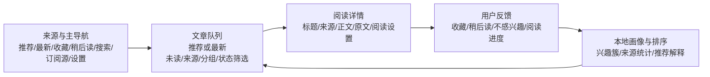
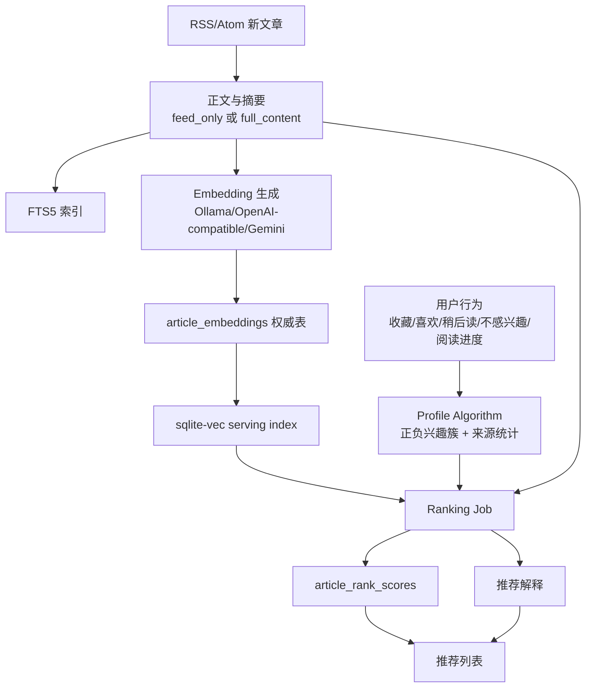
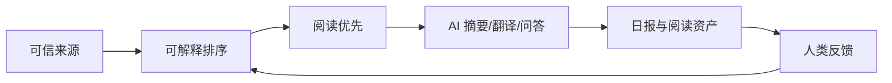

# Dibao 功能调研报告：对标信息中枢 V3

更新时间：2026-06-11 11:29 CST  
调研对象：[Pls-1q43/Dibao](https://github.com/Pls-1q43/Dibao)  
调研方式：公开 README、公开 GitHub metadata、公开文档、仓库树结构，只读分析；未登录、未部署、未写入 Dibao。

## 1. 核心结论

Dibao 不是 QMReader 那种“阅读资产沉淀 + Article Agent”产品。它的核心是一个 **自托管、单用户、本地优先的 RSS 推荐阅读器**：用户仍然自己管理 RSS / Atom 信源，系统不扩展陌生信息流，只在用户已有订阅源内部做排序、去重、搜索、解释和个性化推荐。

它解决的核心问题是“RSS 未读墙”：传统 RSS 按时间堆叠，平台推荐又会夺走信源控制权和阅读数据。Dibao 选择中间路线：信源归用户，排序交给本地推荐系统，解释必须可见，数据留在自托管 SQLite 里。

对信息中枢 V3 的启发很明确：信息中枢现在已经有更强的采集、清洗、评分、摘要、日报和来源健康能力，但 Feed / 日报仍容易像“系统控制台”。Dibao 值得借鉴的不是功能数量，而是它把推荐链路拆成了 **可降级、可解释、可重建、用户可控** 的本地闭环。信息中枢 V3 可以吸收这套“读前排序治理”思想，用来补强 Feed 队列、来源健康、日报候选和推荐解释。

调研时刻公开快照：

| 指标 | 数值 / 状态 | 口径 |
|---|---:|---|
| 仓库创建 | 2026-05-14 | GitHub Repo Metadata |
| 最近更新 | 2026-06-10 | GitHub Repo Metadata |
| 最近 push | 2026-06-10 | GitHub Repo Metadata |
| Stars | 123 | GitHub Repo Metadata，实时变化 |
| Forks | 5 | GitHub Repo Metadata，实时变化 |
| Open issues | 7 | GitHub Repo Metadata，实时变化 |
| 主语言 | TypeScript | GitHub Repo Metadata |
| 当前版本 | 0.1.3 | `package.json` / release notes |
| 许可证 | BUSL-1.1，四年后转 Apache-2.0 | README / LICENSE |
| Roadmap 口径 | MVP 100%，完整愿景约 10-15% | Roadmap |

注意：GitHub stars、issues、Roadmap 状态是 2026-06-11 11:29 CST 左右的公开快照，后续会变化。

## 2. 产品定位

Dibao 的一句话定位是：**把算法推荐放回你的 RSS 信源里**。

这个定位有三个关键边界：

1. 只整理用户订阅的 RSS / Atom，不推荐平台外内容。
2. 数据默认保存在用户自托管环境，不提供官方托管。
3. AI 能力主要用于 embedding 和个性化排序，不是默认摘要、翻译、写作或日报生成。

因此，Dibao 的产品重心不是“信息源越多越好”，而是“已有信源里，今天哪些更值得先读”。这点和信息中枢 V3 当前的目标不同：信息中枢既要做全链路采集，又要做日报、成长、AI 用量、外部源接入和来源健康。Dibao 范围更小，但边界更干净。

它的非目标也很清楚：

| 不做什么 | 意义 |
|---|---|
| 不做多用户团队协作 | 降低权限、协同和数据边界复杂度 |
| 不做官方托管 | 强化本地优先和隐私叙事 |
| 不做社交关注、评论转发 | 避免变成内容平台 |
| 不做平台外内容推荐 | 保留 RSS 信源控制权 |
| 不做云同步 | 先保单实例可信 |
| 不做离线全文文章库 | 避免 MVP 过重 |

对信息中枢 V3 的提醒：我们不能照搬 Dibao 的“只做 RSS 内排序”，因为信息中枢的目标更大。但在 Feed 主入口中，可以给用户一个 Dibao 式的模式：只看我已治理的来源、只按可信排序、推荐理由可追问、低质量诊断收起。

## 3. 功能地图

| 模块 | Dibao 功能 | 用户价值 | 信息中枢 V3 可借鉴点 |
|---|---|---|---|
| 首次设置 | 设置密码、导入 OPML、添加 RSS、选择 provider、首次抓取 | 30 分钟内启动自托管阅读器 | 信息中枢外部源接入也需要更轻的导入向导 |
| 信源管理 | 分组、启用/禁用、添加、发现、导入/导出 OPML、手动刷新 | 用户保留来源控制权 | Sources 页面需要更突出“源是否可用”和“为什么不可用” |
| 来源健康 | 健康、从未抓取、到期、陈旧、失败、禁用 | 失败可恢复，不让用户猜 | 信息中枢来源健康中心应默认展示用户语言原因 |
| RSS 抓取 | ETag / Last-Modified、RSS/Atom 解析、去重、后台刷新 | 降低重复和失败噪音 | 信息中枢可借鉴调度口径和“刷新返回 jobId” |
| 全文抓取 | feed 默认只读 RSS，显式开启网页全文抓取；支持预览和当前响应回溯 | 防止默认抓取过重，同时给高价值源补正文 | 信息中枢正文补抓需要更明确的“按源开启/预览/回溯” |
| 阅读列表 | 推荐、最新、收藏、稍后读、未读、搜索、来源筛选 | 保留传统时间线，同时提供推荐流 | Feed 可保留推荐 / 最新双入口，减少诊断标签 |
| 阅读详情 | 标题、来源、时间、原文、正文、阅读设置、收藏/稍后读/不感兴趣 | 沉浸阅读 | 信息中枢详情页应继续把正文/摘要/翻译放在诊断前 |
| 搜索 | SQLite FTS5，标题/摘要/正文检索，支持筛选 | 本地文章库可查 | 信息中枢可把 Feed 搜索和日报覆盖索引搜索统一 |
| 用户反馈 | 已读、收藏、喜欢、稍后读、隐藏、不感兴趣、阅读进度 | 行为影响后续排序 | 信息中枢可以把“人类反馈”从诊断块变成真实偏好输入 |
| 推荐系统 | baseline + embedding + 行为画像 + 来源统计 + 新鲜度 + 惩罚 | 从未读墙中选优先阅读队列 | 日报候选和 Feed 排序都可借鉴这套分层降级 |
| 推荐解释 | 兴趣、来源、新鲜度、负反馈、重复、fallback | 让排序不是黑盒 | 信息中枢评分解释需要更像“为什么先读”，少展示内部阈值 |
| Provider 设置 | Ollama、OpenAI-compatible、Gemini；测试连接、维度校验 | 低成本模型可接入 | 信息中枢模型用量和模型路由可强化 provider 健康与维度校验 |
| PWA | manifest、图标、基础 service worker、移动端阅读 | 手机可用 | 信息中枢移动端仍需强化长文阅读和触控稳定性 |
| 部署备份 | Docker Compose、SQLite volume、健康检查、升级备份 | 自托管可运维 | 信息中枢本地 Docker 栈也应继续保持一键健康验收 |

## 4. 信息架构

Dibao 的界面不是营销页，也不是仪表盘，而是“阅读器”。它的低保真文档把设计基调定义为：东亚阅读器、报纸感、低饱和、细边线、高文字密度、温润纸白、墨色层级、少卡片、少渐变、少装饰。

核心结构可以概括为：

和 QMReader 相比，Dibao 更弱化“读后资产”，更强调“读前排序”。和信息中枢 V3 相比，Dibao 更克制：它没有把 AI 用量、日报漏斗、阶段修复、评分拆解堆到阅读区，而是把系统状态放在设置、来源管理、推荐透明页和任务状态中。

对信息中枢 V3 来说，值得吸收的结构不是完全复刻页面，而是这条原则：

> 阅读页只放读者要用的信息；治理页才放系统为什么这样运行。

## 5. 数据结构拆解

Dibao 的数据模型非常适合自托管 RSS 推荐系统：业务表是权威数据源，FTS5 和 sqlite-vec 是可重建索引，jobs 是持久化任务队列。

### 5.1 Feed

`feeds` 是来源权威表：

| 字段 | 作用 |
|---|---|
| `folder_id` | RSS 分组 |
| `title/site_url/feed_url/description` | 来源基础信息 |
| `enabled` | 是否启用 |
| `full_content_mode` | `feed_only` 或 `fetch_full_content` |
| `etag/last_modified` | 条件请求 |
| `last_fetched_at/last_success_at/last_error` | 健康诊断 |
| `fetch_interval_minutes` | 刷新间隔 |
| `source_weight` | 用户或系统来源权重 |

最值得信息中枢借鉴的是 `full_content_mode`：默认不全站抓正文，但允许按源开启、预览、回溯。这比“一刀切抓正文”更稳，也比“抓不全用户只能忍”更可治理。

### 5.2 Article

`articles` 保存文章元数据：

| 字段 | 作用 |
|---|---|
| `feed_id/guid/url/canonical_url` | 来源与去重 |
| `title/author/summary` | 列表和搜索基础 |
| `published_at/discovered_at` | 排序与时间线 |
| `content_hash` | 有效正文指纹 |
| `dedupe_key` | 跨源近似去重第一层 |
| `status/deleted_at` | 生命周期 |

它把 `content_hash` 定义为“当前有效正文 hash”，不只是 RSS item 原文 hash。这个细节重要：当网页全文抓取成功后，embedding 和 ranking 可以知道内容真的变了。信息中枢的正文补抓和 AI 重跑也应坚持这种“有效正文版本”概念。

### 5.3 Article Contents

`article_contents` 单独保存正文：

| 字段 | 作用 |
|---|---|
| `content_html/content_text` | HTML 与纯文本正文 |
| `extraction_status` | `pending/feed_only/success/failed/skipped` |
| `extraction_error` | 抽取错误 |
| `extracted_at/updated_at` | 维护时间 |

`feed_only` 被定义为正常路径，不是失败。这一点对信息中枢很有价值：很多 RSS 本来只有摘要，不能都标成“正文失败”；应该区分“来源天然只有摘要”“可补抓但未补”“补抓失败”“正文完整”。

### 5.4 Article States 与 Behavior Events

`article_states` 保存当前状态，`behavior_events` 保存不可变行为日志。两者分离是正确的：

| 层 | 作用 |
|---|---|
| `article_states` | 当前是否已读、收藏、喜欢、稍后读、隐藏、不感兴趣、阅读进度 |
| `behavior_events` | 历史行为事件，用于画像、来源统计和审计 |
| `reader_command_events` | 批量清账等阅读器命令，不作为偏好信号 |

最值得借鉴的是 `reader_command_events` 的边界：批量标记已读是“清理未读债务”，不是“我喜欢这些文章”。信息中枢如果后续支持批量反馈，也要避免把行政动作误写成偏好。

### 5.5 Embedding 与 sqlite-vec

Dibao 把向量系统拆得很干净：

| 表/模块 | 作用 |
|---|---|
| `embedding_providers` | provider 类型、模型、维度、连接测试状态 |
| `embedding_indexes` | 模型/维度/距离函数对应的一套索引配置 |
| `article_embeddings` | 向量权威存储，保存 float32 BLOB 和 content_hash |
| `article_vector_rows` | 业务 article_id 与 sqlite-vec rowid 映射 |
| sqlite-vec 虚拟表 | 可重建 serving index |

它明确：sqlite-vec 不是权威数据源，可从 `article_embeddings` 重建。信息中枢现在更多依赖模型输出字段和 AI usage 记录；如果以后做本地向量推荐，也应采用类似“权威表 + serving index 可重建”的边界。

### 5.6 Ranking 与 Explanation

推荐结果分两层：

| 表 | 作用 |
|---|---|
| `article_rank_scores` | 预计算排序分，包含 interest/source/freshness/state/diversity/penalty 等分量 |
| `article_rank_explanations` | 推荐解释 payload |

更重要的是它支持 `rank_context`。无 provider 时是 `base`，有 embedding 时是类似 `rec_v2:embedding:cocoon_5:schema_2` 的上下文。这样不同算法版本、不同模型维度、不同重排策略不会混在一起。

信息中枢 V3 的日报候选、Feed 排序、成长维度、评分体系也需要类似 `rank_context` / `report_context`：用户看到的“为什么这条入报/为什么这条先读”必须能追溯到当时使用的策略版本，而不是只有一个最新分数。

### 5.7 Jobs

`jobs` 表承载进程内任务队列：

| 字段 | 作用 |
|---|---|
| `type/status` | 任务类型与状态 |
| `payload_json/error` | 输入和错误 |
| `attempts/max_attempts` | 重试 |
| `run_after/started_at/finished_at` | 调度和耗时 |

任务类型包括 `feed_refresh`、`content_extract`、`embedding_generate`、`ranking_recalculate`、`vector_index_rebuild`、`duplicate_group_rebuild`、`interest_cluster_label_rebuild` 等。它不是大规模分布式队列，但对单用户自托管足够清晰。

信息中枢 V3 的日报生成进度、来源补抓、AI 重跑、BestBlogs 原文补抓、邮箱 ingest 后处理，也应保持类似可观察 job 模型：返回 jobId、可轮询、失败阶段可见、payload 脱敏。

## 6. 推荐系统拆解

Dibao 的推荐系统不是一个神秘模型，而是一套规则 + embedding + 用户行为的可解释系统。

推荐链路：

### 6.1 行为权重

Dibao 对行为信号非常谨慎：

| 行为 | 推荐语义 |
|---|---|
| impression | 统计信号，不直接强负反馈 |
| open | 极弱正信号 |
| read_progress >= 50% | 可更新正向兴趣 |
| read_complete | 较强正信号 |
| like | 最强正信号 |
| favorite | 强正信号，偏保存 |
| read_later | 中度正信号 |
| hide / not_interested | 负向兴趣 |
| quick_bounce | 弱负，不单独建负向簇 |
| mark_read | 清账，不作为强偏好 |

这点对信息中枢 V3 非常关键。我们现在有“值得重点关注 / 要看看 / 少给我看 / 不符合口味”等反馈，但需要进一步明确哪些进入长期偏好，哪些只影响当前日报/当前来源，哪些只是阅读命令。

### 6.2 兴趣簇

Dibao 不用单一平均向量表达用户兴趣，而是维护多个正向和负向兴趣簇：

| 设计 | 价值 |
|---|---|
| 正向 / 负向分开 | 避免不喜欢的主题污染喜欢的主题 |
| merge/create 阈值 | 防止偶然行为剧烈改变画像 |
| 时间衰减 | 避免旧兴趣永久占据 |
| 数量上限 | 防止簇爆炸 |
| 过拟合诊断 | 判断某个兴趣是否来自单源或弱信号 |
| 手动标签与自动标签分离 | 解释元数据不影响排序 |

信息中枢 V3 的成长维度和用户反馈画像可以借鉴这套“兴趣簇 + 诊断”的思想。但不要把它直接做成复杂的用户可见图表。用户需要的是“为什么今天多给我看 AI Agent / 少给我看泛商业行情”，不是一堆向量术语。

### 6.3 降级策略

Dibao 的推荐系统强调 fallback：

| 状态 | 降级行为 |
|---|---|
| 无 provider | 使用基础排序 |
| 有 provider 但 embedding 未完成 | 新文章使用 pending score，不从推荐流消失 |
| 无用户画像 | 用新鲜度、来源、状态排序，并提示仍在学习 |
| provider 失败 | 阅读仍可用，推荐退化 |
| 索引损坏 | 从权威向量表重建 |

这直接对应信息中枢 V3 的痛点：Claude/Fable 这类重要新闻不能因为 AI 评分/摘要失败就完全从日报消失。Dibao 的原则可以转化为信息中枢规则：

> 新鲜高价值内容先进入可见层，再等待 AI 精修；AI 失败只能降低置信度，不能让重大内容消失。

### 6.4 推荐解释

Dibao 的解释不是展示完整分数，而是 3-5 条主要原因：

- 匹配兴趣
- 来源权重
- 新鲜度
- 负向兴趣扣分
- 重复惩罚
- fallback 状态

信息中枢 V3 的评分解释现在容易展示太多内部标签和 raw 状态。应该改成 Dibao 式用户语言：为什么先读、为什么降权、为什么只是复核、缺什么才能进日报。

## 7. UI/交互拆解

Dibao 的 UI 设计非常克制，最值得信息中枢学习的不是颜色，而是信息层级。

### 7.1 设计原则

| Dibao 原则 | 对信息中枢的意义 |
|---|---|
| 文字优先 | Feed / 日报页不要让诊断卡片抢正文 |
| 高信息密度但不拥挤 | 列表可以紧凑，但要有清晰标题、来源、摘要 |
| 少卡片、少渐变 | 信息中枢的阅读区应减少浮层卡片堆叠 |
| 细边线、墨色层级 | 用结构分区，不用大面积颜色块 |
| 卡片圆角不超过 8px | 适合工具型阅读产品 |
| 阅读参数用 CSS Variables | 长文阅读体验可个性化 |
| 移动端触控目标 >= 44px | 信息中枢已有多轮触控修复，应继续保持门禁 |

### 7.2 三栏阅读器

Dibao 的 wireframe 是全局侧栏 + 主内容，阅读列表和详情分离。QMReader 是更明显的五段式阅读台。信息中枢 V3 当前已经在向三栏阅读台靠拢，可以综合两者：

| 区域 | QMReader 启发 | Dibao 启发 | 信息中枢建议 |
|---|---|---|---|
| 来源栏 | 来源/资产上下文 | 订阅源管理和健康状态 | Feed 内来源栏可折叠，主治理去 Sources |
| 文章列表 | 卡片摘要和资产徽标 | 推荐/最新/未读切换 | 常驻只显示评分、等级、内容状态 |
| 阅读详情 | 原文/翻译/重写/Agent | 正文阅读设置和反馈动作 | 阅读优先，诊断折叠 |
| 系统诊断 | 较弱 | 来源健康/推荐透明页 | 放 Sources / AI Usage / 日报运行分析 |

### 7.3 移动端

Dibao 的移动端要求很具体：

- 底部导航固定。
- 推荐解释用 Bottom Sheet。
- 核心动作不依赖 hover。
- 阅读页底部工具条不能遮挡正文结尾。
- 主流程必须在手机浏览器可用。

信息中枢 V3 之前已经多次修复移动端重叠、触控、长文滚动问题。Dibao 的文档可以作为继续做 UI 门禁的依据：所有阅读页和诊断页都要有移动端 screenshot/assert，不能只跑 desktop build。

## 8. 与 QMReader 对比

| 维度 | QMReader | Dibao | 对信息中枢 V3 的含义 |
|---|---|---|---|
| 核心问题 | 读过的信息如何沉淀为资产 | 未读 RSS 如何排序和解释 | 信息中枢需要同时做读前排序和读后资产 |
| AI 位置 | Article Agent、翻译、重写、对话 | Embedding provider、推荐排序 | Feed 可学 QMReader，候选排序可学 Dibao |
| 资产层 | 翻译、重写、点评、对话、公开 RSS | 收藏、稍后读、行为画像、rank/explanation | 信息中枢需要统一 `readingAssets` |
| 推荐边界 | 不强调推荐系统 | 只在订阅源内推荐 | 信息中枢日报应有“可信源内优先”模式 |
| 来源治理 | 简单状态 | feed diagnostics、发现、全内容开关 | Sources 健康中心更应学 Dibao |
| 数据所有权 | 公开资产和登录资产混合 | 自托管 SQLite，本地优先 | 信息中枢私密源/邮箱默认不能公开资产化 |
| UI 气质 | 多栏阅读工作台 | 安静报纸感阅读器 | 信息中枢应减少控制台感 |
| 对外输出 | 资产 RSS | OPML 迁移、PWA | 信息中枢可做私有导出和安全摘要订阅 |

一句话判断：

- QMReader 教信息中枢：读完之后留下什么资产。
- Dibao 教信息中枢：还没读之前如何可信排序。

## 9. 与信息中枢 V3 对标

信息中枢 V3 当前能力明显比 Dibao 更宽：

| 能力 | Dibao | 信息中枢 V3 |
|---|---|---|
| RSS 抓取 | 有 | 有 |
| OPML | 有 | 可接入 / 已规划 |
| 来源健康 | 中等 | 已做更完整全链路健康 |
| 正文抽取 | 有，按源开启 full content | 有，更复杂但需要更可见 |
| AI 摘要/翻译 | 非核心 | 核心链路 |
| 日报 | 无 | 核心模块 |
| 成长维度 | 无 | 核心模块 |
| 模型用量 | 非主线 | 已规划/实现为仪表盘 |
| 外部源邮箱/BestBlogs | 无 | 已接入方向 |
| 阅读资产 | 弱 | 可借鉴 QMReader 强化 |
| 推荐排序 | 强主线 | Feed 和日报候选仍需更稳定 |

所以，信息中枢不应照搬 Dibao 变成 RSS reader，而应吸收以下底层设计：

1. 推荐链路必须可解释：每条先读/入报/降权都有用户语言理由。
2. 推荐链路必须可降级：AI 未完成时仍能进入复核和覆盖索引。
3. 推荐链路必须可重建：分数、解释、模型版本、上下文要能追溯。
4. 来源控制权必须清楚：用户能知道源是否启用、何时成功、是否需要全文抓取。
5. 阅读命令和偏好信号必须分离：批量清理不等于喜欢。

## 10. 应该抄 / 不该抄 / 改造后再抄

### 应该直接借鉴

| 设计 | 为什么 |
|---|---|
| `recommended` 与 `latest` 双入口 | 推荐流和传统时间线都要保留，用户才不会不信系统 |
| 推荐解释只展示 3-5 条主因 | 避免把内部评分拆解变成阅读噪音 |
| feed health 简洁状态 | 先显示用户能懂的健康状态，再展开诊断 |
| OPML 作为迁移承诺 | 外部订阅源接入和导出必须不锁用户 |
| full content 按源开启 | 避免默认抓取过重，也让正文差的源有治理入口 |
| `feed_only` 不等于失败 | 这是正文完整性治理的关键语义 |
| `rank_context` | 评分/日报入选必须可追踪到策略版本 |
| jobs 可观察 | 生成日报、补抓、AI 重跑必须有进度和失败阶段 |
| 阅读设置 token | 长文阅读体验要用户可调 |

### 不该照搬

| 设计 | 原因 |
|---|---|
| 只做 RSS 内推荐 | 信息中枢还要覆盖网页监控、邮箱、BestBlogs、日报、成长 |
| 单用户单实例全部假设 | 信息中枢有 admin/acceptance 等验收账号和权限场景 |
| 主要依赖 embedding 推荐 | 信息中枢需要评分、摘要、日报策略、人工反馈共同决策 |
| 不做摘要/翻译主链路 | 信息中枢用户明确需要摘要、翻译、日报和中文化 |
| BUSL/fair-code 商业模式 | 这只是 Dibao 项目选择，不是信息中枢设计输入 |
| 默认不做平台外发现 | 信息中枢需要关注页、榜单、邮箱等外部入口 |

### 改造后再吸收

| Dibao 设计 | 信息中枢改造方式 |
|---|---|
| 兴趣簇 | 转成成长维度 / 主题偏好 / 来源偏好，不暴露向量术语 |
| 推荐透明页 | 转成 Feed 排序解释 + 日报候选解释 + Sources 健康解释 |
| source_weight | 转成来源等级、质量分、用户偏好权重、日报权重 |
| duplicate penalty | 转成日报同主题合并和 Feed 重复降噪 |
| full content backfill-current | 转成按来源/日期/失败状态批量补正文 |
| reader command events | 转成“清账/批量处理”审计，避免误入偏好画像 |
| provider dimensions 校验 | 转成模型配置健康检查和向量索引版本管理 |

## 11. 对信息中枢 V3 的落地建议

### P0：马上影响可信可用

1. **Feed 排序上下文**
   - 给 Feed 列表和日报候选增加 `rankContext/reportContext` 概念。
   - 用户看到的评分、入报、降权理由要绑定当时策略版本。
   - 避免“现在模型修过了，但日报解释还像旧逻辑”的错配。

2. **推荐 / 最新双队列**
   - Feed 首页保留“推荐优先”和“最新时间线”两个强入口。
   - 重大 AI 关键词命中但未评分内容，至少出现在最新和复核队列。
   - 这能直接减少“抓到了但日报没看到”的不信任。

3. **正文状态语义重整**
   - 把正文分为：原文完整、feed 摘要可读、片段可读、标题级、补抓失败、待补抓。
   - 不要把 `feed_only` 或 RSS 摘要源简单标成失败。
   - Feed 详情和 Sources 健康都复用同一语义。

4. **日报候选降级规则**
   - 借鉴 Dibao pending score：未评分、摘要失败、embedding/AI 未完成的高价值内容不能从候选池消失。
   - 状态应是“待复核 / AI 待补 / 摘要降级”，而不是不出现。

5. **任务进度可观察**
   - 日报生成、来源抓取、补正文、重跑摘要/翻译都要返回 jobId。
   - 工作台显示当前阶段、耗时、最近日志、失败点和完成入口。

### P1：提升长期体验

1. **用户反馈画像**
   - 把“值得重点关注 / 要看看 / 少给我看 / 不符合口味”拆成短期日报反馈、长期来源偏好、长期主题偏好。
   - 行政性动作如批量清账、标记已读不能自动进入正向偏好。

2. **来源级 full content 策略**
   - 为每个来源提供正文策略：仅 RSS、智能补抓、强制全文、禁用全文。
   - Sources 里显示预览结果和风险：反爬、内容短、HTML 噪音、正文质量。

3. **推荐解释降噪**
   - Feed 卡片只显示“为什么先读”的一句话。
   - 评分拆解、日报解释、AI 失败原因折叠到工具区。
   - 用户不应被 `summary_must_be_chinese` 这类系统语言打断。

4. **搜索与覆盖索引统一**
   - 日报全池摘要索引和 Feed 搜索共享搜索能力。
   - 用户能搜“Claude Fable”并看到：抓到了哪些、是否评分、是否入报、为什么没入。

5. **推荐透明页**
   - 不做给普通用户看的复杂算法页。
   - 做给系统维护者看的“排序健康”：候选量、评分覆盖、摘要覆盖、来源分布、失败任务。

### P2：长期能力

1. **本地向量推荐**
   - 如果后续引入 sqlite-vec / pgvector，必须采用 Dibao 式权威表 + serving index 可重建。
   - 每个模型维度对应独立 index，避免混用。

2. **兴趣簇诊断**
   - 可在 Settings / AI 管理中展示“你最近偏好的主题”，但不直接把向量簇暴露到 Feed。
   - 提供手动重命名、合并、忽略能力。

3. **数据迁移与私有导出**
   - OPML 导入导出作为来源迁移。
   - 日报 Markdown、全池索引、阅读资产作为内容迁移。
   - 邮箱和私密源默认不进入公开导出。

4. **移动端 PWA 化**
   - 信息中枢如果要成为日常阅读工具，最终需要 PWA 安装、离线 app shell、移动端长文阅读验收。

## 12. 风险与不足

Dibao 也有明显边界，不能被神化。

| 风险 | 说明 |
|---|---|
| 自托管门槛 | 目标用户需要懂 Docker、OPML、provider，普通用户不一定能顺畅部署 |
| AI 价值集中在 embedding | 对需要摘要、翻译、日报的人来说，AI 阅读增强不足 |
| 推荐效果依赖行为积累 | 冷启动阶段未必比时间线强很多 |
| Provider 配置复杂 | 模型、维度、Base URL、API Key 都可能配错 |
| SQLite 单实例上限 | 对个人足够，对多用户或大规模内容不适合 |
| 许可证限制 | BUSL-1.1 不是 OSI 开源许可证，商业托管/竞品化使用受限 |
| 公开文档与实现可能有差异 | Roadmap 自称 MVP 100%，但仍有 Todo，例如移动端 polish、读进度捕获、Explanation v1 等 |

其中最值得信息中枢警惕的是“推荐效果依赖行为积累”。信息中枢不能只靠用户反馈学习，因为用户最先需要的是可靠默认值：重要 AI 新闻不能漏、泛商业噪声不能占日报、来源失败要可解释。

## 13. 三阶段落地路线

### 阶段一：把 Dibao 的“可信排序”引入 Feed / 日报

目标：让用户知道为什么先读、为什么入报、为什么没入报。

建议动作：

- 增加 `rankContext/reportContext`。
- Feed 增加推荐 / 最新双入口。
- 日报候选对高价值关键词做 pending fallback。
- 推荐解释统一为用户语言，不展示 raw 分数和阈值。
- 任务进度全部 job 化。

### 阶段二：把 Dibao 的“来源控制权”引入 Sources

目标：每个来源都能解释抓取、正文、AI、日报覆盖状态。

建议动作：

- 来源详情显示正文策略：RSS 摘要 / 智能补抓 / 强制全文 / 禁用。
- 添加全文抓取预览和当前响应回溯。
- 区分 feed_only、原文待补、补抓失败、正文完整。
- 来源健康默认展示用户语言，技术细节折叠。

### 阶段三：把 Dibao 的“本地画像”改造成信息中枢偏好系统

目标：长期让信息中枢更懂 Reise，但不变成黑盒。

建议动作：

- 将用户反馈拆为短期日报偏好、长期主题偏好、来源偏好。
- 引入兴趣簇或主题簇，但只在治理页展示。
- 建立偏好审计：哪些行为影响了哪些主题 / 来源。
- 保留一键重置或忽略错误偏好。

## 14. 最终判断

Dibao 对信息中枢 V3 最有价值的不是“再做一个 RSS 阅读器”，而是三条工程产品原则：

1. **推荐不能黑盒**：排序必须有理由，而且理由要面向读者。
2. **AI 不能成为阻塞点**：embedding、摘要、评分未完成时，内容仍要以降级方式可见。
3. **索引必须可重建**：FTS、向量、排序解释、兴趣标签都应是派生层，不是唯一事实源。

QMReader 给信息中枢补的是“读后资产”；Dibao 给信息中枢补的是“读前排序”。两者合起来，才是信息中枢 V3 最需要的闭环：

如果下一轮要把 Dibao 的启发真正落到信息中枢 V3，我建议优先从 **Feed 推荐 / 最新双队列 + 日报候选 pending fallback + 来源全文策略** 三件事开始。这三件事能直接改善用户当前最在意的问题：抓到了但看不见、看见但不知道为什么、日报漏掉重要新闻。

## 参考资料

- [Dibao README](https://github.com/Pls-1q43/Dibao/blob/main/README.md)
- [GitHub Repo Metadata](https://api.github.com/repos/Pls-1q43/Dibao)
- [MVP PRD](https://github.com/Pls-1q43/Dibao/blob/main/docs/mvp-prd.md)
- [Engineering Blueprint](https://github.com/Pls-1q43/Dibao/blob/main/docs/engineering-blueprint.md)
- [API Contract](https://github.com/Pls-1q43/Dibao/blob/main/docs/api-contract.md)
- [Database Schema](https://github.com/Pls-1q43/Dibao/blob/main/docs/database-schema.md)
- [Profile Algorithm v0](https://github.com/Pls-1q43/Dibao/blob/main/docs/profile-algorithm-v0.md)
- [Wireframes](https://github.com/Pls-1q43/Dibao/blob/main/docs/wireframes.md)
- [Design Tokens](https://github.com/Pls-1q43/Dibao/blob/main/docs/design-tokens.md)
- [Roadmap](https://github.com/Pls-1q43/Dibao/blob/main/docs/roadmap.md)
- [Release Notes v0.1.3](https://github.com/Pls-1q43/Dibao/blob/main/docs/release-notes-v0.1.3.md)
