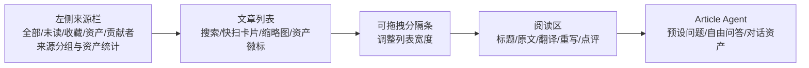

# QMReader 功能调研报告：对标信息中枢 V3

更新时间：2026-06-11 11:07 CST  
调研对象：[QMReader 文章页](https://rss.qiaomu.ai/?entry=170c5bf62f2adbec2707d71585114580)  
调研方式：公开页面、公开 API、公开资产 RSS、用户截图，只读分析；未登录、未写入、未触碰私有数据。

## 1. 核心结论

QMReader 不是一个普通 RSS 阅读器。它更像一个轻量的“阅读资产工作台”：左侧管理订阅源，中间进行文章快扫，右侧完成沉浸阅读，最右侧用 Article Agent 做文章级问答；阅读后的中文翻译、乔木风格重写、人工点评、文章对话会沉淀为公开资产，并可通过独立 RSS 二次分发。

它解决的核心问题不是“抓更多信息”，而是“把读过、加工过、问过的问题变成可复用资产”。这一点对信息中枢 V3 很重要：当前信息中枢已经有采集、评分、摘要、翻译、日报、来源健康，但用户感受到的压力仍然是信息多、诊断多、阅读和沉淀不够顺。QMReader 的启发是把系统诊断后移，把“阅读动作”和“二次资产”放到主界面中心。

调研时刻公开快照：

| 指标 | 数值 | 口径 |
|---|---:|---|
| 来源总数 | 59 | `/api/sources` 返回 |
| 启用来源 | 35 | `enabled=true` |
| 禁用来源 | 24 | `enabled=false` |
| 来源分类 | article 45 / news 10 / podcast 4 | `category` 聚合 |
| 来源状态 | ok 37 / pending 21 / error 1 | `status` 聚合，实时变化 |
| 文章条目 | 304 | `/api/entries` 返回 |
| 有资产覆盖文章 | 39 | `assets.latestAt > 0` |
| 中文翻译资产 | 12 | `assets.translation=true` |
| 乔木风格重写资产 | 28 | `assets.rewrite=true` |
| 人工点评 | 2 | `assets.comments` 加总 |
| 文章对话 | 40 | `assets.chatMessages` 加总 |

注意：这些数字是 2026-06-11 11:07 CST 左右的公开接口快照。QMReader 是实时系统，来源刷新和资产生成会改变这些数字。

## 2. 产品定位

QMReader 的产品定位可以概括为三层：

1. RSS 阅读器：订阅源、未读、收藏、搜索、来源分组、文章列表、原文阅读。
2. AI 阅读助理：中文翻译、乔木风格重写、文章级问答、预设 prompt、用户自带模型配置。
3. 阅读资产库：翻译、重写、点评、文章对话、贡献者资产页、公开资产 RSS。

它没有把“评分、日报、漏斗、阶段修复、来源健康”作为主界面中心，而是把它们替换成更贴近读者的动作：读原文、看中文、看重写、问文章、写点评、复制链接、订阅资产。这个选择让界面负担轻很多。

对信息中枢 V3 的启发：信息中枢现在更像“信息工厂控制台”，QMReader 更像“读者工作台”。信息中枢需要同时保留工厂能力和阅读能力，但默认入口应该更偏向读者工作台，把诊断集中到 Sources、日报运行分析、模型用量，而不是常驻压在 Feed 详情里。

## 3. 功能地图

| 模块 | QMReader 功能 | 价值 |
|---|---|---|
| 来源管理 | `/api/sources` 返回来源、分类、状态、错误、抓取时间、条目数；前端可启停来源、刷新全部 | 来源治理轻量可见 |
| 文章列表 | 全部、未读、收藏、资产、贡献者；搜索；来源过滤；文章卡片含标题、摘要、来源、时间、图片、资产徽标 | 快速扫读，降低选择成本 |
| 阅读详情 | 标题、中文标题、元信息、打开原文、获取原文、复制链接、收藏；原文/中文翻译/乔木重写三标签 | 阅读路径清楚，主次明确 |
| 原文获取 | `reader-fetch-original` 触发内容获取；文章详情返回 HTML content | 允许 RSS 摘要不足时补正文 |
| 中文翻译 | 登录并配置模型后生成；资产可复制、可分享、可出现在资产 RSS | 让英文内容进入中文阅读流 |
| 乔木风格重写 | 面向中文传播的二次表达，不只是直译 | 把信息转为可读观点稿 |
| 人工点评 | 观点、疑问、行动、引用、资料等模板；可排序、有用反馈 | 让人的判断进入资产层 |
| Article Agent | 文章侧栏问答，预设总结要点、质疑观点、行动建议、金句摘录、证据清单、前提拆解、分享文案、选题角度 | 将“读完后要想什么”产品化 |
| 公开资产 | `/assets.xml`、`/assets/translation.xml`、`/assets/rewrite.xml`、`/assets/comments.xml`、`/assets/chat.xml` | 阅读成果可被订阅和再分发 |
| 贡献者 | `/api/contributors`、贡献者资产页 | 把个人阅读沉淀变成轻社区 |
| AI 设置 | 浏览器本地保存 API Key；支持 DeepSeek、OpenRouter、OpenAI、Grok、Groq、Together、Kimi、智谱、通义、硅基流动、豆包、AiHubMix、Workers AI 等模板 | 用户自带模型，降低平台成本和密钥责任 |

## 4. 信息架构

QMReader 的页面结构是五段式：

这个结构比信息中枢 V3 之前的 Feed 诊断式详情更像长期阅读台。它把高频的“选文章、读文章、问文章”放在一个横向流里，而不是让用户在多个页面之间跳转。

值得注意的细节：

- 来源栏不是全站导航，而是阅读上下文；这和信息中枢全局侧栏不同。
- 文章列表有可拖拽宽度，适合不同屏幕和不同阅读习惯。
- 右侧 Article Agent 可收起，避免一直占据阅读空间。
- 移动端把阅读区和 Agent 重新堆叠，说明它优先服务桌面长文阅读。

## 5. 数据结构拆解

公开 API 暴露的结构非常直接，适合信息中枢参考。

### Source

典型字段：

| 字段 | 含义 |
|---|---|
| `id` | 来源稳定 ID |
| `name` | 来源名 |
| `category` | `article/news/podcast` |
| `siteUrl` | 站点地址 |
| `description` | 来源说明 |
| `note` | 人工备注，例如禁用原因 |
| `enabled` | 是否启用 |
| `status` | `ok/error/pending` 等 |
| `error` | 最近错误 |
| `fetchedAt` | 最近抓取时间 |
| `entryCount` | 当前条目数 |

它没有复杂的来源健康漏斗，但字段足够让用户理解“这个源有没有开、最近有没有抓、为什么关”。信息中枢 V3 的来源健康中心比它更强，但展示上可以学习它的克制：先让用户看到状态，再展开全链路诊断。

### Entry

典型字段：

| 字段 | 含义 |
|---|---|
| `id` | 条目 ID |
| `sourceId` | 来源 ID |
| `title/titleZh` | 原标题/中文标题 |
| `summary/summaryZh` | 原摘要/中文摘要 |
| `content` | 详情页 HTML 原文 |
| `link` | 原文链接 |
| `author` | 作者 |
| `published/publishedTs` | 发布时间 |
| `image/audio` | 媒体 |
| `contentHash` | 内容指纹 |
| `assets` | 阅读资产状态与预览 |

`assets` 是它最有价值的设计。列表不需要加载完整翻译或完整对话，只需要知道是否有资产、最近资产是什么、预览是什么。

### Asset

`assets` 里有四类：

| 类型 | 字段表现 | 作用 |
|---|---|---|
| translation | `translation=true`、`previews.translation` | 中文翻译 |
| rewrite | `rewrite=true`、`previews.rewrite` | 乔木风格重写 |
| comments | `comments=count`、`items.comments` | 人工点评 |
| chat | `chatMessages=count`、`items.chat` | 文章对话 |

资产还带 `author/model/text/at/helpfulCount`，这让用户知道“是谁用什么模型生成或沉淀的”。信息中枢 V3 目前也记录模型调用和 AI 用量，但阅读页没有把“这条内容的可复用资产”组织成一等公民。

## 6. AI 能力拆解

QMReader 的 AI 不是一个后台全自动流水线，而是“用户触发 + 用户自带模型”的阅读增强。

### 模型配置

前端暴露多个 OpenAI-compatible 模板，包括 DeepSeek、OpenRouter、OpenAI、Grok、Groq、Together、Kimi、智谱、通义、硅基流动、豆包、AiHubMix、Cloudflare Workers AI。API Key 说明为只保存在当前浏览器。

优势：

- 平台不直接承担用户 API 成本。
- 用户能按任务选择更合适的模型。
- 登录态资产可带上作者和模型，增加透明度。

风险：

- 浏览器本地保存密钥仍需要明确安全提示。
- 普通用户配置模型有门槛。
- 如果模型输出不稳定，平台很难统一保证翻译/重写质量。

### Article Agent

Article Agent 的预设 prompt 很产品化：

- 总结要点
- 质疑观点
- 行动建议
- 金句摘录
- 证据清单
- 前提拆解
- 分享文案
- 选题角度

这些 prompt 的共同点是面向“读完后怎么理解和使用”，而不是面向系统诊断。对信息中枢 V3 来说，这比单纯“摘要/翻译/评分解释”更接近用户价值。尤其是“证据清单、前提拆解、行动建议、选题角度”可以直接迁移到 Feed 详情和日报重点文章。

### 自动重写

来源管理里有 `autoRewrite` 状态，显示最近自动重写的 sourceIds、cached、failed、startedAt、finishedAt。它相当于小批量 AI 后处理，但没有把失败细节压到阅读页。

信息中枢 V3 的 AI 处理链路更复杂，但可以借鉴这个呈现方式：在阅读页只显示“有无可读资产”，在诊断页再显示队列、失败和成本。

## 7. 与信息中枢 V3 对标

| 维度 | QMReader | 信息中枢 V3 当前方向 | 判断 |
|---|---|---|---|
| 采集规模 | 轻量，59 源、304 条快照 | 更大规模，含 RSS、网页、监控、邮箱、BestBlogs、日报 | 信息中枢更强 |
| 阅读体验 | 三栏/五段式，读者优先 | 正在从诊断面板转阅读台 | 应继续向 QMReader 学习 |
| AI 资产 | 翻译、重写、点评、对话作为公开资产 | 有摘要/翻译/评分/日报，但资产组织不足 | 应重点借鉴 |
| 日报 | 基本没有高质量日报模块 | 信息中枢核心能力之一 | 不应照搬 |
| 来源健康 | 简单状态与错误 | 全链路来源健康中心 | 信息中枢更强，但 UI 要降噪 |
| 模型用量 | 用户自带模型为主 | 平台侧模型调用统计与成本治理 | 两者可互补 |
| 社区资产 | 贡献者、公开点评、公开对话 | 当前更偏个人系统 | 可谨慎借鉴 |
| 隐私治理 | 公开资产很强，但边界需要用户理解 | 信息中枢含邮箱/私密源，隐私要求更高 | 不能直接照搬公开默认 |

## 8. 应该抄 / 不该抄 / 改造后再抄

### 应该直接借鉴

| 设计 | 迁移到信息中枢的方式 |
|---|---|
| 阅读资产徽标 | Feed 卡片只常驻显示“已摘要/已翻译/有问答/有人工标注”，替代一堆 raw 状态标签 |
| Article Agent 预设问题 | Feed 详情增加“问这篇文章”侧栏或折叠面板，内置证据清单、前提拆解、行动建议、选题角度 |
| 原文/翻译/重写标签 | Feed 详情把阅读内容放前，诊断后移 |
| 公开资产目录思路 | 对非私密内容生成“我的阅读资产”页：翻译、摘要、标注、问答、日报引用 |
| 来源栏作为阅读上下文 | Feed 内部来源栏继续做，不和全局导航混在一起 |
| 资产 RSS | 对公开日报、公开精选、公开读后笔记生成 RSS/JSON Feed |

### 不应该照搬

| 设计 | 原因 |
|---|---|
| 默认公开资产 | 信息中枢会接邮箱、私密网页、个人关注源，默认公开风险过高 |
| 用户必须自带 API Key | 信息中枢需要后台自动日报和批处理，不能完全依赖用户前端配置 |
| 弱来源健康 | 信息中枢的问题恰恰在全链路质量，不能只显示 ok/error |
| 无日报主链路 | 你的核心诉求包含每日高质量摘要、趋势、重点文章和全池覆盖 |
| 只有翻译/重写两类 AI 产物 | 信息中枢还需要评分、分类、成长轴、日报入选解释、来源健康 |

### 需要改造后再抄

| QMReader 能力 | 信息中枢改造版 |
|---|---|
| 乔木风格重写 | 改成“Reise 可读版”：事实不丢、中文自然、保留链接、适合长期知识库 |
| 文章对话 | 需要绑定原文证据、摘要、翻译、日报引用，避免回答漂移 |
| 人工点评 | 改成“人类反馈 + 偏好画像 + 后续评分训练数据”，不要只做评论区 |
| 贡献者 | 先做个人资产，再考虑团队/公开贡献者 |
| 自动重写 | 改为可观察的后台任务，接入模型用量仪表盘和失败重试 |

## 9. 对信息中枢 V3 的可落地建议

### P0：阅读体验与资产组织

1. Feed 详情从“诊断优先”改为“阅读资产优先”：标题、来源、时间、评分、等级、正文完整性后，直接进入摘要/原文/翻译/重写/问答。
2. 为每篇文章建立统一 `readingAssets` 概念：摘要、翻译、重写、问答、人工反馈、日报引用都归到一个资产层。
3. Feed 列表只保留 3-4 个高价值徽标：评分、等级、内容状态、资产状态；其他诊断折叠。
4. 右侧或折叠区增加 Article Agent：总结要点、证据清单、前提拆解、行动建议、选题角度。
5. 解决当前 HTML 原文显示不友好问题：原文渲染必须净化 HTML、保留段落/引用/列表/代码/链接格式。

### P1：日报与资产闭环

1. 日报重点文章应该直接关联 Feed 阅读资产：每条重点文章可查看原文、摘要、翻译、问答、入报理由。
2. 日报全池摘要索引可以借鉴 QMReader 资产预览：每条显示一句可读摘要、状态和下一步动作，不展示 raw 阈值。
3. 生成“我的日报资产”：每日结论、重点文章、未读但值得看、用户反馈、可复制 Markdown、可订阅 Feed。
4. 把“问这篇文章”的高质量回答反向纳入日报素材，而不是只做临时对话。

### P2：公开/半公开资产与协作

1. 对可公开内容提供资产 RSS：例如“公开精选文章”“公开日报”“公开读后问答”。
2. 对私密内容默认不公开，只允许本地资产库或显式分享。
3. 增加贡献者/账户维度时，先服务个人多设备同步，再考虑社区化。
4. 把用户反馈模板化：值得重点关注、要复核、不符合口味、可写成文章、可进入日报。

## 10. 风险与不足

QMReader 的优点很明确，但也有边界：

- 它的来源健康较弱，只有状态、错误和抓取时间，不能解释“正文为什么不完整、AI 为什么失败、为什么没进日报”。
- 它的资产数量仍小，说明资产沉淀依赖用户触发或有限自动化，不等于全量内容都高质量处理。
- 它没有复杂日报模块，因此无法直接解决信息中枢 V3 的“每日高质量简报、趋势、重点文章、全池覆盖”问题。
- 它的公开资产设计很有传播价值，但对信息中枢的邮箱、私密关注页、个人反馈来说必须默认私密。
- 用户自带 API Key 降低平台成本，但提升了使用门槛，也会带来模型输出质量不一致。

## 11. 三阶段落地路线

### 阶段一：把 Feed 做成真正阅读台

目标：用户打开 Feed 后先读内容，而不是先看系统诊断。

关键动作：

- 文章列表卡片学习 QMReader：标题两行、摘要两行、来源/时间、评分/等级、资产徽标、可选缩略图。
- 详情页标签固定为：摘要、原文、翻译、重写、知识/问答。
- 诊断区统一折叠为“工具与诊断”。
- 右下角悬浮按钮和底部遮挡全部清理。

验收标准：

- 抽查 10 篇文章，默认首屏都能直接阅读。
- 原文 HTML 不裸露标签，段落/列表/引用/链接格式正确。
- 资产状态一眼可见，但不抢正文。

### 阶段二：阅读资产层

目标：让摘要、翻译、重写、问答、反馈都成为可复用对象。

关键动作：

- 后端统一返回 `readingAssets` 或兼容字段聚合。
- 前端展示“已有资产”和“一键生成/重试”。
- Article Agent 回答可保存为文章资产。
- 人类反馈不只用于 UI，也进入偏好画像和后续日报筛选。

验收标准：

- 每篇文章能看到资产状态和最近资产预览。
- 资产可复制、可跳转、可进入日报引用。
- 模型用量能追踪到具体资产生成场景。

### 阶段三：日报资产与公开输出

目标：把日报从一次性 Markdown 变成可阅读、可追踪、可复用的知识资产。

关键动作：

- 日报重点文章与 Feed 资产互链。
- 日报全池摘要索引复用资产预览逻辑。
- 对可公开内容输出 RSS/JSON Feed。
- 私密源默认不进入公开资产。

验收标准：

- 每条日报重点文章都能追到原文、摘要、翻译、问答和入报理由。
- 每条候选池内容都有摘要和去向。
- 复制 Markdown 与页面阅读都不出现裸 URL、raw 分类和机器阈值话术。

## 12. 最终判断

QMReader 最值得学习的不是某个按钮，而是产品哲学：让阅读后的动作沉淀成资产。它没有把“系统已经做了多少工作”放到用户面前，而是把“用户现在能读什么、能问什么、能复用什么”放到界面中心。

信息中枢 V3 的能力上限更高：它有更复杂的采集、来源健康、AI 用量、日报和全链路质量治理。但如果默认界面仍然把用户推向诊断、阈值、失败状态和 raw 标签，能力越强，阅读负担反而越大。

因此，信息中枢下一步不应简单复制 QMReader，而应吸收它的阅读资产思路：

- Feed 是读者工作台，不是流水线日志。
- Sources 是治理面，不是阅读面。
- Daily 是正式出版物，不是候选池调试页。
- AI Usage 是成本与稳定性仪表盘，不是文章详情的噪音。
- 阅读后的摘要、翻译、重写、问答、反馈，应统一沉淀为资产。

这条路更适合 Reise 的信息中枢：既保留后台强治理，又让前台变成真正愿意长期使用的个人知识入口。
